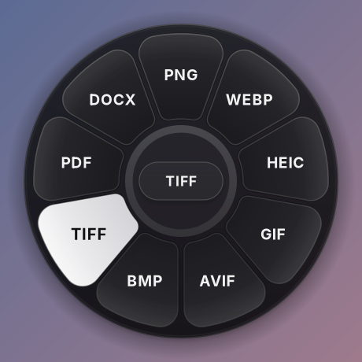
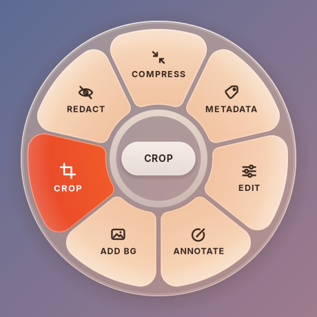
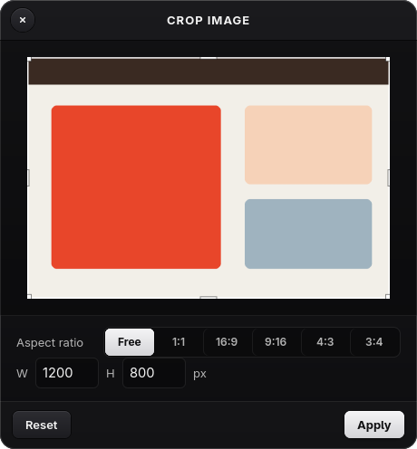
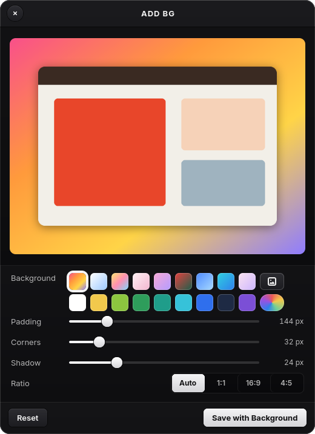

# RingConvert

A file converter for the GNOME desktop that lives under your cursor. Drag a file, press **Shift**,
and a ring of formats opens where you are. Drop the file on a format and the converted copy appears
next to the original. A second ring holds quick tools: compress, crop, redact and more.

Made for **Fedora 44–45 Workstation with GNOME 50–51 on Wayland**.
Latest release: **[1.0.0](https://github.com/Krkr8/RingConvert/releases/tag/v1.0.0)** ·
[Changelog](CHANGELOG.md) · [Contributing](CONTRIBUTING.md)

<p align="center">
  
  
</p>

## Features

- **Convert ring:** only the formats that make sense for the file you're dragging:
  - images: PNG, JPG, WEBP, HEIC, AVIF, GIF, BMP and TIFF, plus PDF and DOCX
  - PDF to DOCX, images or plain text
  - office documents (Writer, Calc and Impress formats, DOCX/XLSX/PPTX) and Markdown/HTML/text
  - audio and video (MP4, MKV, WEBM, MOV, GIF, MP3, M4A, WAV, OGG, FLAC)
- **Tools ring:** Compress, Metadata, Edit, Annotate, Add Background, Crop and Redact. Some run at
  once; the others open a small editor window.
- **Batches:** drag several files at once to convert them all.
- **Readout and notifications:** the centre of the ring shows the hovered format, the file size, or
  the progress of a long job. When the job ends, a notification has a **Show in Files** button.
- **Never overwrites:** `Photo.jpg` becomes `Photo.png`, then `Photo 2.png`, and so on. Tools add a
  word, and results chain: `Photo Cropped.jpg`, then `Photo Cropped With Background.png`. If the
  folder isn't writable, results go to your Downloads folder.
- **Other ways in:** a keyboard shortcut, a **Files right-click menu**, **Open With**, and a
  command-line tool for everything.

## Requirements

- Fedora 44 or 45 Workstation, GNOME 50 or 51, Wayland session. Other distributions and desktops are untested;
  KDE and X11 sessions aren't supported.
- About 1 GB of disk for the conversion back ends, mostly LibreOffice, pandoc and the PyPI
  libraries.
- The installer sets up everything else with `dnf` and `pip --user`:
  - GTK 4, libadwaita, PyGObject, Pillow, PyMuPDF and img2pdf
  - LibreOffice, pandoc, ghostscript, exiftool, ffmpeg and avifenc
  - nautilus-python, plus pdf2docx, python-docx and pillow-heif from PyPI

## Install

RingConvert has two parts: the **app**, which does the converting, and a small **GNOME Shell
extension**, which opens the ring at the cursor when you press Shift during a drag. `install.sh`
installs both.

Get the code, either the latest release:

```sh
curl -L https://github.com/Krkr8/RingConvert/archive/refs/tags/v1.0.0.tar.gz | tar xz
cd RingConvert-1.0.0
```

or a clone (`git clone https://github.com/Krkr8/RingConvert.git && cd RingConvert`). Put it
somewhere you'll keep it, e.g. `~/Apps/RingConvert`, then run this from its folder:

```sh
./install.sh
```

Run it as your normal user, not with `sudo`. It asks for your password for the `dnf` steps and
installs:

- the Fedora packages and the Python packages above
- the `ringconvert` and `ringconvert-cli` commands, for your user only
- a background service, started now and at every login
- the **Super+Shift+C** shortcut
- the **Files right-click menu** and **Open With**
- the **GNOME Shell extension**

Then:

1. **Log out and back in once.** GNOME only loads a newly installed Shell extension at login.
2. **Restart Files** so it picks up the right-click menu: run `nautilus -q`, then open Files again.

Keep the folder where it is: the installed commands run the code from it. If you move it, run
`./install.sh` again from the new place.

`./install.sh --user-only` reinstalls only the desktop parts, without dnf, pip or sudo. To use a
different shortcut: `RINGCONVERT_SHORTCUT="<Super><Alt>r" ./install.sh --user-only`.

### The extension on extensions.gnome.org

The Shell extension is also listed on [extensions.gnome.org](https://extensions.gnome.org) and in
the **Extension Manager** app as *RingConvert*. On its own it does nothing: it needs the app from
this repository. `install.sh` already installs the same extension, so you don't need both; if you
do install it from there, it simply replaces the copy `install.sh` put in place.

### Updating

Download the new release (or `git pull` in your clone), run `./install.sh` again from its folder,
then log out and back in so GNOME loads the new extension. Installs of 0.1.0 used different IDs
(`io.github.ringconvert.RingConvert` and `ringconvert@ringconvert.github.io`); `install.sh` removes
that old copy for you.

### ffmpeg

Fedora's own ffmpeg (`ffmpeg-free`) has no x264 encoder. For better H.264 output, enable
[RPM Fusion](https://rpmfusion.org/Configuration); `install.sh` then offers to swap in its full
ffmpeg.

## Using it

### Drag + Shift

1. Start dragging any file, from Files or from the desktop, and keep the mouse button down.
2. Press **Shift**. The convert ring opens under the cursor.
3. Press **Shift** again to switch to the tools ring. Each further press switches back and forth.
4. Drop the file on a segment. Conversions and Compress run straight away; the other tools open a
   small editor window.
5. To cancel, release anywhere outside the ring or press **Esc**.

Tools that work on one file at a time (Crop, Edit, Annotate, Redact) are greyed out when you drag
several files.

### Keyboard shortcut

**Super+Shift+C** opens the ring at the cursor, or closes it if it's open. Then drag files onto it.
You can change the key combination in Settings → Keyboard → View and Customize Shortcuts → Custom
Shortcuts.

### Files right-click menu

Select one or more files, right-click, then **Convert with RingConvert ▸**. Pick a format, or open
**Tools ▸**. With several files selected, only the formats that all of them can become are listed.
The job runs in the background and a notification tells you when it's done.

### Open With

Right-click a file, then **Open With… → RingConvert**. The ring opens for that file: hover a format
and click it.

### Tools

<p align="center">
  
  
</p>

| Tool | For | Does | Output |
|---|---|---|---|
| Compress | images, PDFs, audio (not WAV), video | Images re-encoded (JPG/WEBP quality ~75, PNG reduced to 256 colours, metadata dropped), PDFs through ghostscript, video at CRF 28, audio at about 128 kbit/s (FLAC stays lossless) | `Name Compressed.ext` |
| Metadata | images, PDFs, audio, video, office files | Lists every tag (exiftool); **Strip all metadata** writes a clean copy (images, PDFs, audio, video and DOCX; photos keep their orientation and colour profile) | `Name Clean.ext` |
| Edit | images | Rotate, flip, resize (with lock), brightness, contrast, saturation, live preview | `Name Edited.ext` |
| Annotate | images, PDFs | Arrow, rectangle, highlighter, pen, text, colours, undo; real annotations in PDFs | `Name Annotated.ext` |
| Add BG | images | Puts a screenshot on a gradient, colour or picture, with padding, corners, shadow and ratio | `Name With Background.png` |
| Crop | images | Free or fixed ratios (1:1, 16:9, 9:16, 4:3, 3:4), exact W × H | `Name Cropped.ext` |
| Redact | images, PDFs | Black boxes. In PDFs the text underneath is really removed, not just covered. The copy has no metadata | `Name Redacted.ext` |

### Command line

Everything also works in a terminal:

```sh
ringconvert-cli "Page 001.pdf" --list           # what the rings would offer
ringconvert-cli "Page 001.pdf" --to jpg         # → Page 001.jpg (Page 001 1.jpg, 2.jpg… if multi-page)
ringconvert-cli *.heic --to jpg                 # batch
ringconvert-cli clip.mov --to mp4
ringconvert-cli photo.jpg --tool crop --ratio 16:9          # → photo Cropped.jpg
ringconvert-cli photo.jpg --tool crop --box 100,50,800,600
ringconvert-cli shot.png --tool add-bg --background gradient:#ff5f6d,#ffc371 --padding 120 --corners 40
ringconvert-cli photo.jpg --tool edit --rotate 90 --resize 1200x --saturation 1.2
ringconvert-cli doc.pdf --tool redact --rect 1:72,100,200,20  # page:x,y,w,h in PDF points
ringconvert-cli photo.jpg --tool metadata                   # list tags
ringconvert-cli photo.jpg --tool metadata --strip           # → photo Clean.jpg
ringconvert-cli video.mp4 --tool compress                   # → video Compressed.mp4
ringconvert-cli --check                                     # which back ends are installed
```

The GUI also has a few options:

```sh
ringconvert            # show the ring
ringconvert --tools    # start on the tools ring
ringconvert photo.jpg  # ring for that file: hover and click a format
ringconvert --show     # toggle the ring (what the shortcut runs)
ringconvert --quit     # stop the background service
```

## Known limits

- **Wayland:** normal apps can't watch the keyboard globally or place their own windows. The
  drag + Shift trigger and the placement at the cursor therefore come from the GNOME Shell
  extension. Without it, the shortcut, the Files menu and Open With still work, but the ring opens
  wherever GNOME puts it.
- **The extension needs a log-out:** GNOME Shell on Wayland can't load new or updated extension
  code while you're logged in. After installing or updating, log out and back in once.
- The extension is built for GNOME 50 and 51. Other GNOME versions won't load it.
- Shift switches rings only during a drag, or while the ring itself has the keyboard focus.
- The Files menu is hidden for folders, files that aren't on your disk, and selections of more than
  200 files.
- Fedora's Pillow can't write AVIF, so `avifenc` does it. If only the ffmpeg fallback is available,
  AVIF loses transparency.
- PDF to DOCX keeps the text and layout as well as pdf2docx can; scanned PDFs have no text to
  extract.
- The ring and the tool windows are black smoked glass in light and dark mode.
  `RINGCONVERT_THEME=warm` brings back the original cream-peach ring with orange hover (the tool
  windows stay smoked).

## Uninstall

```sh
./uninstall.sh
```

This stops the service and removes the shortcut, the autostart entry, D-Bus activation,
"Open With", the Files menu, the Shell extension (switched off and unloaded at once), the commands
and any folders the installer created that are now empty. Your converted files, the Fedora packages
and the Python libraries pip installed stay; the script prints how to remove those libraries.
Afterwards, run `nautilus -q` so Files drops the menu. `./uninstall.sh --user-only` keeps the
commands installed.

## Troubleshooting

- **Shift does nothing while dragging:** check that the extension is loaded:
  `gnome-extensions info ringconvert@krkr8.github.io` should say it's enabled and active. If
  you installed it during this session, log out and back in. Its log lines are in
  `journalctl -b -o cat /usr/bin/gnome-shell | grep ringconvert`.
- **No right-click menu:** `rpm -q nautilus-python`, then `nautilus -q` and open Files again.
- **A conversion is missing or fails:** `ringconvert-cli --check` lists the back ends it can't find,
  with the package to install. Two lines are optional extras that Fedora's own packages don't have:
  `pillow avif` (avifenc does that job) and `ffmpeg libx264` (only with RPM Fusion's ffmpeg).
- **Something in the ring misbehaves:** run `ringconvert --quit`, then
  `RINGCONVERT_DEBUG=1 ringconvert --service`, repeat the problem and keep what it prints.
- **The desktop misbehaves after installing:** switch the Shell extension off from a text console.
  Press Ctrl+Alt+F3, log in, and run:

  ```sh
  DBUS_SESSION_BUS_ADDRESS=unix:path=/run/user/$(id -u)/bus \
      gnome-extensions disable ringconvert@krkr8.github.io
  ```

  Go back with Ctrl+Alt+F2 (or F1). If GNOME won't start at all, run this in the console instead,
  then log in again:
  `mv ~/.local/share/gnome-shell/extensions/ringconvert@krkr8.github.io ~/ringconvert-extension.off`

## Reporting a problem

Open an [issue](https://github.com/Krkr8/RingConvert/issues) with your Fedora and GNOME versions
(`gnome-shell --version`), the output of `ringconvert-cli --check`, and the steps that go wrong.
For ring problems, the `RINGCONVERT_DEBUG=1` output from the troubleshooting list above helps most.
Check it for file names you'd rather not share before posting.

## Development

```sh
PYTHONPATH=src python3 -m ringconvert.cli FILE --to jpg      # without installing
PYTHONPATH=src python3 -m ringconvert.app --stay [FILES]     # the GUI (RINGCONVERT_DEBUG=1 traces)
python3 -m pytest -q                                         # tests; missing back ends are skipped
RINGCONVERT_SHELL_TESTS=1 python3 -m pytest -q tests/test_shell_extension.py
```

The tests generate their own sample files. The Shell extension tests run a private, headless
GNOME Shell with its own D-Bus, settings and runtime folder, so nothing touches your session. The
install tests run the scripts in a throwaway home folder; in test mode the scripts refuse to run
without one. Step-by-step manual checks are in [TESTING.md](TESTING.md); how to contribute is in
[CONTRIBUTING.md](CONTRIBUTING.md), and how a release is made in
[docs/RELEASING.md](docs/RELEASING.md).

## Licence

RingConvert is free software: you can redistribute it and modify it under the terms of the
[GNU General Public License](LICENSE), version 3 or (at your option) any later version. Every
source file carries an `SPDX-License-Identifier: GPL-3.0-or-later` line. The programs and libraries
it uses (LibreOffice, ffmpeg, PyMuPDF, pdf2docx and others) come with their own licences.

## Inspiration

RingConvert is an independent Linux implementation of an idea seen in a short video of a macOS
tool: drag a file, press Shift, and pick a format from a ring around the cursor. No code, artwork or
other assets from that tool were used: the code, the icon and every graphic here were written and
drawn from scratch for GNOME, and the name is RingConvert's own. This project isn't affiliated
with, endorsed by or connected to that tool or its makers.
